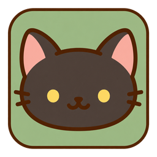
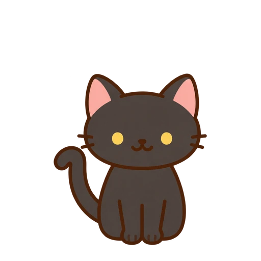
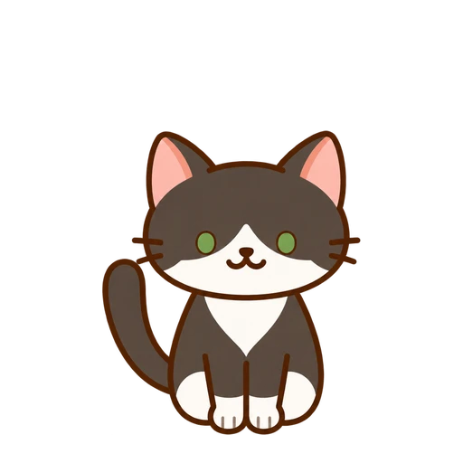
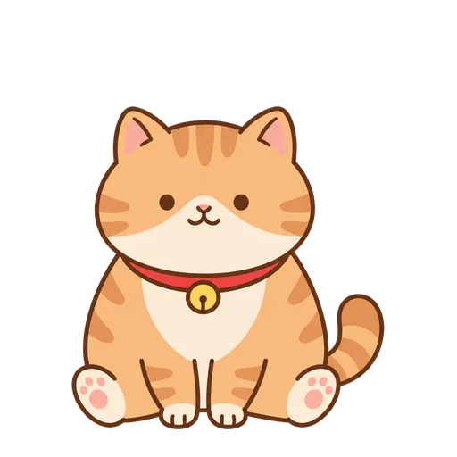
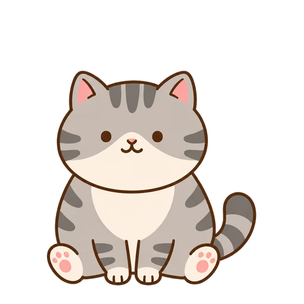
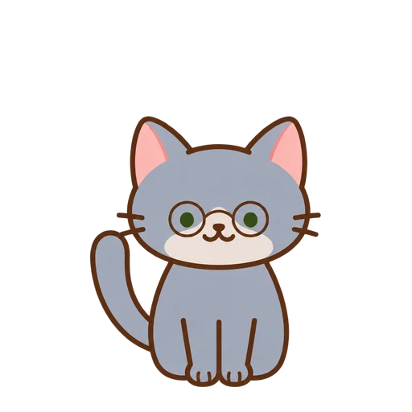
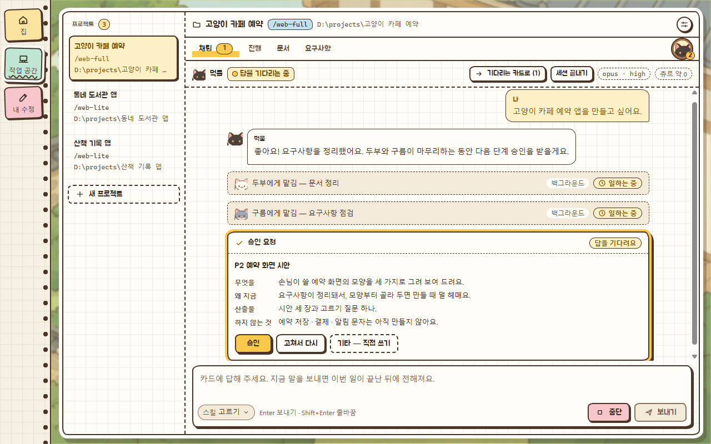
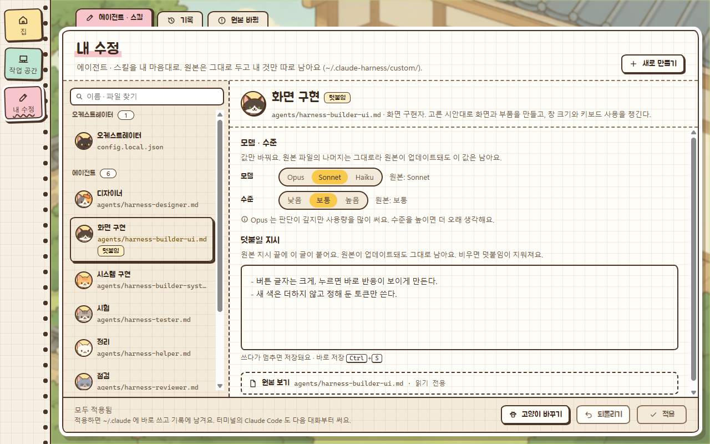

<div align="center">



# Nyanitor

**Claude Code 에이전트들이 사는 아늑한 집 — 에이전트는 모두 고양이입니다.**

[claude-harness](https://github.com/nerohee/claude-harness) 를 창에서 쓰는 데스크톱 앱입니다. 프로젝트를 계획하고 맡기고 지켜보는 동안, 일하는 에이전트들은 작은 한옥 마당에서 지냅니다.

[](https://github.com/nerohee/Nyanitor/actions/workflows/ci.yml)
[](https://github.com/nerohee/Nyanitor/releases)
[](LICENSE)
[](LICENSE-ART.md)


[English](README.md) · **한국어**

<picture>
  <source media="(prefers-color-scheme: dark)" srcset="assets/readme/home-dark.png">
  
</picture>

</div>

> [!NOTE]
> 지금은 한국어 화면만 지원합니다. 아직 첫 출시 전입니다.

## 왜 Nyanitor?

[claude-harness](https://github.com/nerohee/claude-harness) 는 요구사항에서 출시까지, 단계마다 승인을 받으며 진행하는 Claude Code 에이전트 · 스킬 묶음입니다. 터미널에서도 잘 돌지만, Nyanitor 는 이것을 창으로 옮깁니다.

- **누가 일하는지 보입니다.** 에이전트마다 고양이 한 마리. 오케스트레이터가 화면 작업을 맡기면, 그 고양이가 캣휠로 가서 일합니다.
- **글 대신 단추로 답합니다.** Claude Code 의 질문 · 단계 승인 · 권한 요청이 카드로 옵니다.
- **에이전트를 내 것으로.** 모델 · 수준 · 지시문을 바꾸고, 하네스가 업데이트돼도 내 수정은 남습니다.
- **내 Claude Code 그대로.** 이 PC 에 설치된 Claude Code 를 실행할 뿐입니다. 서버 · 계정 · 수집 없음, 로그인 정보는 읽지 않습니다.

## 고양이들

<table>
  <tr>
    <td align="center"><br><b>먹물</b><br><sub>오케스트레이터</sub></td>
    <td align="center"><br><b>물감</b><br><sub>디자이너</sub></td>
    <td align="center"><br><b>단추</b><br><sub>화면 구현</sub></td>
    <td align="center"><br><b>나비</b><br><sub>시스템 구현</sub></td>
    <td align="center"><br><b>깨비</b><br><sub>시험</sub></td>
    <td align="center"><br><b>두부</b><br><sub>정리</sub></td>
    <td align="center"><br><b>구름</b><br><sub>점검</sub></td>
  </tr>
</table>

집에서 고양이를 누르면 그 에이전트의 역할 · 모델 · 수준이 보입니다. 내가 만든 에이전트에게 고양이를 골라 줄 수도 있습니다.

## 할 수 있는 것

### 🏠 고양이 집
에이전트들이 마당에서 쉬고 자고 놉니다. 상태 카드는 Claude Code · 로그인 · git · 하네스가 준비됐는지 보고, 빠진 것을 순서대로 안내합니다. Claude 사용량과 앱 판도 여기서 봅니다.


### 💬 작업 공간
프로젝트 폴더를 고르고, 마크다운 편집기에 요구사항을 적고, 오케스트레이터와 채팅합니다. 질문 · 단계 승인 · 권한 요청은 카드로 와서 눌러 답합니다.



### 📋 진행 보기
단계 보드, 지금 일하는 고양이, 짧은 요약 로그, 프로젝트 문서를 한 탭에서 봅니다.


### ✏️ 내 수정
에이전트 · 스킬 파일 편집, 모델 · 수준 바꾸기, 새로 만들기. 바꾼 것은 모두 기록되고 되돌릴 수 있으며, 하네스가 업데이트돼도 남습니다.



### 그 밖에
- **하네스 설치 · 업데이트** — 바뀌는 파일을 미리 보여 주고, `~/.claude` 를 먼저 백업하고, 언제든 되돌립니다.
- **트레이 · 알림** — 창을 닫아도 작업은 계속되고, 내가 할 일이 생겼을 때만 알립니다.
- **폴더 신뢰** — 남이 만든 폴더를 쓰기 전에 그 폴더의 Claude Code 설정(자동 실행 명령 · 허용 규칙 · MCP)을 보여 주고 믿을지 묻습니다.
- **밝게 · 어둡게** (OS 따라), 키보드 조작, 작은 화면에 맞는 배치.

## Claude Code 와 어떻게 동작하나

Nyanitor 는 화면일 뿐입니다. Claude Code 를 넣어 두거나, 고치거나, 서버에서 돌리지 않습니다.

- **내가 설치한 `claude`** 를 이 PC 에서 그대로 실행합니다 (Claude Code 의 `stream-json` 입출력).
- **로그인은 Anthropic 의 것.** 로그인 확인은 `claude auth status`, 로그인은 터미널에서 `claude auth login` 을 엽니다. 로그인 정보 · 토큰 · 키체인은 읽지도 저장하지도 보내지도 않습니다.
- **서버도 중간 단계도 없음.** 개발자나 다른 곳으로 보내는 것이 없습니다. 사용량은 모두 내 Claude 구독이나 내 API 키로 바로 청구됩니다.
- 환경에 `ANTHROPIC_API_KEY` 가 있어도 Claude Code 에 넘기지 않습니다. 잊고 있던 키 대신 Claude Code 로그인으로 돌게 하려는 것입니다. API 크레딧으로 쓰려면 Claude Code 에 Claude Console 계정으로 로그인하세요. Claude Code 자체의 로그인 방법은 막지 않습니다.

## 쓰기 전에 필요한 것

- Windows 10 · 11, macOS (Apple Silicon · Intel), Linux (x86_64)
- [Claude Code](https://docs.claude.com/en/docs/claude-code) — 먼저 설치해 두세요. 로그인은 앱에서 안내합니다 (터미널에서 미리 해 둬도 됩니다).
- git

## 설치

[Releases](https://github.com/nerohee/Nyanitor/releases) 에서 내 OS 에 맞는 파일을 받습니다. *(아직 첫 출시 전입니다.)*

| OS | 받을 파일 | 설치 |
|---|---|---|
| Windows | `Nyanitor_<판>_x64-setup.exe` | 실행해서 설치 |
| macOS (Apple Silicon) | `Nyanitor_<판>_aarch64.dmg` | 열어서 `Nyanitor` 를 응용 프로그램 폴더로 끌기 |
| macOS (Intel) | `Nyanitor_<판>_x64.dmg` | 위와 같음 |
| Linux | `Nyanitor_<판>_amd64.AppImage` (권장) 또는 `.deb` | 아래 참고 |

<details>
<summary><b>처음 열 때</b> (설치본에 코드 서명이 없습니다)</summary>

- **Windows** — "Windows의 PC 보호" 창이 뜨면 「추가 정보」 → 「실행」.
- **macOS** — *Apple은 "Nyanitor"에 … 악성 코드가 없음을 확인할 수 없습니다* 가 뜨면 「완료」를 누릅니다. 그다음 「시스템 설정」 → 「개인정보 보호 및 보안」 → 아래쪽 「그래도 열기」 (막힌 뒤 약 한 시간 동안 보입니다) → 암호 → 앱을 다시 엽니다. 터미널로는 `xattr -dr com.apple.quarantine /Applications/Nyanitor.app`.
- **Linux (AppImage)** — `chmod +x Nyanitor_*.AppImage` → `./Nyanitor_*.AppImage`. Ubuntu 22.04 이후에서 FUSE 오류가 나면 `sudo apt install libfuse2` (24.04 는 `libfuse2t64`).
- **Linux (.deb)** — `sudo apt install ./Nyanitor_<판>_amd64.deb`. deb 설치는 앱 안 업데이트가 되지 않아, 새 판은 Releases 에서 다시 받습니다.

</details>

**업데이트** — 앱이 켜질 때 새 판을 확인하고, 있으면 고양이 집 상태 카드에 알려 줍니다. 「바뀐 점 보기」 → 「설치하고 다시 시작」. 업데이트 파일은 서명을 확인한 뒤에만 설치합니다.

**Claude Code 로그인** — 로그인이 안 돼 있으면 작업 공간의 「로그인」 단추가 Anthropic 의 로그인 흐름을 엽니다 — Windows 는 콘솔 창, macOS 는 터미널 앱, Linux 는 붙여 넣을 명령.

## 데이터와 개인 정보

| 무엇 | 어디에 | 앱을 지우면 |
|---|---|---|
| 프로젝트 목록 · 채팅 기록 · 사용량 · 폴더 신뢰 기록 (SQLite) | Windows `%APPDATA%\io.github.nerohee.nyanitor\` · macOS `~/Library/Application Support/io.github.nerohee.nyanitor/` · Linux `~/.local/share/io.github.nerohee.nyanitor/` | 남음. Windows 는 제거할 때 「앱 데이터 지우기」를 고르면 지워짐, macOS · Linux 는 폴더를 직접 지움 |
| 로그 · 화면 캐시 | Windows `%LOCALAPPDATA%\io.github.nerohee.nyanitor\` · macOS `~/Library/Logs/io.github.nerohee.nyanitor/` · `~/Library/Caches/` · Linux `~/.local/share/io.github.nerohee.nyanitor/` · `~/.cache/` | 위와 같음 |
| 하네스 원본 · 내 수정 · 백업 | `~/.claude-harness/` | 남음 — 앱 없이 터미널에서도 쓰는 곳 |
| 설치된 하네스 · Claude Code 설정 | `~/.claude/` | 남음 |

- 채팅 기록에는 도구 입력 · 성공한 도구 결과 · CLI 오류 출력을 저장하지 않습니다. 비밀값이 섞일 수 있어서입니다. DB 에서 지운 글은 파일에서도 덮어씁니다.
- 대화 전문은 Claude Code 가 스스로 `~/.claude/projects/` 에 남깁니다.
- 앱은 외부 서버로 아무것도 보내지 않습니다. 네트워크는 Claude Code 와 git 이 씁니다.

## 개발

[Rust](https://rustup.rs/), Node.js 24, 그리고 OS 별 [Tauri 준비물](https://v2.tauri.app/start/prerequisites/) 이 필요합니다 (Windows: MSVC 도구 모음, Visual Studio Build Tools 의 "C++를 사용한 데스크톱 개발", WebView2).

```sh
npm install
npm run tauri dev
```

- `npm run dev` — 화면만 브라우저로 (`http://localhost:1420`). 가짜 데이터로 돕니다.
- `CLAUDE_CONFIG_DIR` · `CLAUDE_HARNESS_HOME` 으로 시험용 설정을 가리키면 실제 설정을 건드리지 않습니다.

```sh
npm run check        # 타입 검사 · eslint · clippy · rustfmt
npm run test         # Vitest (화면) + cargo test (Rust, 가짜 Claude CLI)
npm run e2e          # 실제 앱 창 E2E (Windows) — tauri-driver · WebdriverIO · 가짜 CLI
npm run screenshots  # README 캡처를 assets/readme/ 에 다시 만들기
npm run tauri build  # 설치본 — src-tauri/target/release/bundle/
```

E2E 와 캡처는 임시 폴더에서 돌고 실제 앱 데이터를 건드리지 않습니다. `cargo install tauri-driver --locked` 와, 저장소 뿌리에 이 PC 의 WebView2 판에 맞는 `msedgedriver.exe` 가 필요합니다 ([msedgedriver-tool](https://github.com/chippers/msedgedriver-tool)).

### 기술
[Tauri 2](https://v2.tauri.app/) (Rust) · React + TypeScript + Vite · zustand · CodeMirror 6 · react-markdown · SQLite (rusqlite)

## 그림

고양이와 집 그림은 AI 로 생성한 뒤 스크립트로 맞췄습니다 (OpenAI 이미지 API). 프롬프트와 스크립트는 [`scripts/cat-art/`](scripts/cat-art/) 에 있습니다.

## 라이선스

- 코드 — [MIT](LICENSE)
- 고양이 · 집 그림과 앱 · 트레이 아이콘 — [CC BY-NC 4.0](LICENSE-ART.md) (비상업 · 출처 표시)
- Jua 글꼴 — [SIL Open Font License](src/assets/fonts/jua/OFL.txt)

Nyanitor 는 무료이며 유료 등급이 없습니다.

## 고지

Nyanitor 는 무료 오픈 소스 개인 프로젝트입니다. **Anthropic 과 관계가 없고, Anthropic 이 만들거나 보증하거나 후원한 앱이 아닙니다.** Claude 와 Claude Code 는 Anthropic, PBC 의 상표입니다.

Nyanitor 는 Claude Code 를 포함하거나 고치거나 서버에서 돌리지 않습니다. 각 사용자가 자기 PC 에 설치한 Claude Code CLI 를 실행하며, 각 사용자는 자기 Claude 계정이나 API 키로 로그인합니다.
