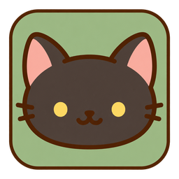
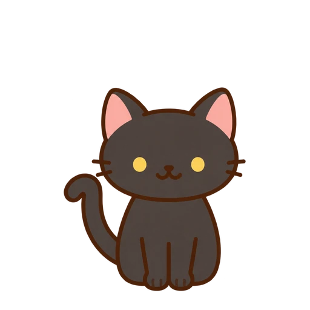
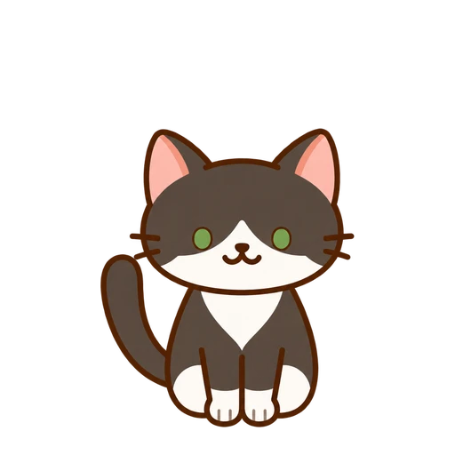
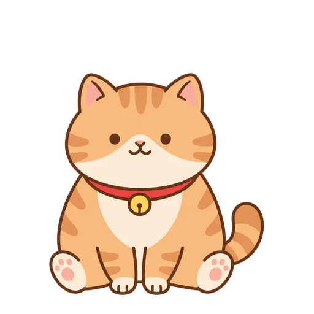
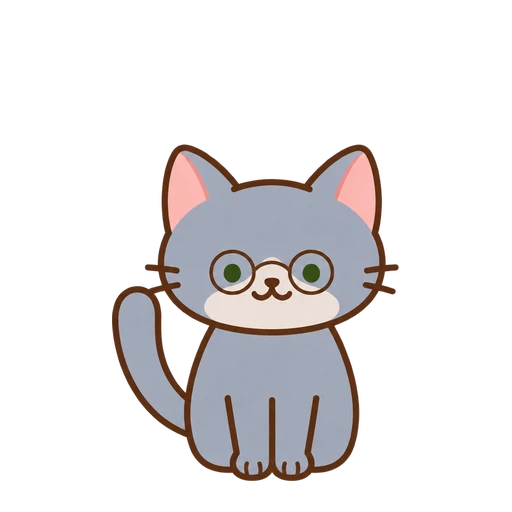
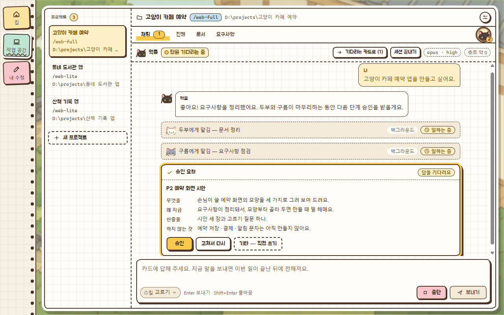
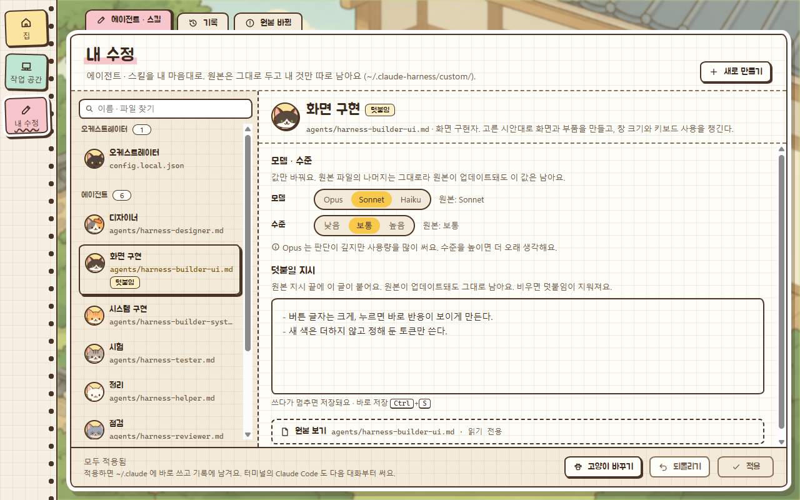

<div align="center">



# Nyanitor

**A cozy desktop home for your Claude Code agents — every agent is a cat.**

A desktop app for [claude-harness](https://github.com/nerohee/claude-harness): plan, run and watch your projects from a window, while the agents doing the work live in a little Korean hanok house.

[](https://github.com/nerohee/Nyanitor/actions/workflows/ci.yml)
[](https://github.com/nerohee/Nyanitor/releases)
[](LICENSE)
[](LICENSE-ART.md)


**English** · [한국어](README.ko.md)

<picture>
  <source media="(prefers-color-scheme: dark)" srcset="assets/readme/home-dark.png">
  
</picture>

</div>

> [!NOTE]
> The app's interface is **Korean only** for now. Nyanitor has not had its first release yet.

## Why Nyanitor?

[claude-harness](https://github.com/nerohee/claude-harness) is a set of Claude Code agents and skills that takes a project from requirements to release, asking for your approval at every stage. It works great in a terminal — Nyanitor puts it in a window:

- **See who is working.** Each agent is a cat. When the orchestrator hands a task to the UI builder or the tester, that cat walks to the cat wheel and gets busy.
- **Answer with buttons, not typing.** Questions, stage approvals and permission requests from Claude Code show up as cards.
- **Make the agents yours.** Change an agent's model, effort or instructions, and keep your edits when the harness updates.
- **Your own Claude Code, untouched.** Nyanitor runs the Claude Code CLI installed on your computer. No server, no accounts, no telemetry — and it never reads your credentials.

## Meet the cats

<table>
  <tr>
    <td align="center"><br><b>Mukmul</b><br><sub>orchestrator</sub></td>
    <td align="center"><br><b>Mulgam</b><br><sub>designer</sub></td>
    <td align="center"><br><b>Danchu</b><br><sub>UI builder</sub></td>
    <td align="center"><br><b>Nabi</b><br><sub>system builder</sub></td>
    <td align="center"><br><b>Kkaebi</b><br><sub>tester</sub></td>
    <td align="center"><br><b>Dubu</b><br><sub>helper</sub></td>
    <td align="center"><br><b>Gureum</b><br><sub>reviewer</sub></td>
  </tr>
</table>

Click a cat in the house to see its role, model and effort level. You can also give your own agents a cat of their choice.

## Features

### 🏠 The house
Your agents relax, nap and play in the courtyard. The status card checks that everything is ready — Claude Code, sign-in, git and the harness — and walks you through whatever is missing. It also shows your Claude usage and the app version.


### 💬 Workspace
Pick a project folder, write your requirements in the Markdown editor, and chat with the orchestrator. Questions, stage approvals and permission requests arrive as cards you answer with a click.



### 📋 Progress
A stage board, the cats currently at work, a short log of what happened, and the project's documents — all in one tab.


### ✏️ My edits
Edit agent and skill files, change models and effort levels, or create new ones. Every change is recorded and can be undone, and your edits survive harness updates.



### And more
- **Harness install & update** — preview every file that will change, back up `~/.claude` first, roll back any time.
- **Tray & notifications** — close the window and the work keeps going; you're only notified when something needs you.
- **Folder trust** — before using a folder someone else made, Nyanitor shows its Claude Code settings (hooks, allow rules, MCP servers) and asks whether you trust it.
- **Light and dark** (follows your OS), keyboard navigation, and a layout that fits small screens.

## How it works with Claude Code

Nyanitor is a front end. It does not include, modify or host Claude Code.

- It launches **your own installed `claude` binary** on your computer, unmodified, using Claude Code's `stream-json` input and output.
- **Sign-in is Anthropic's own.** To check sign-in it runs `claude auth status`; to sign in it opens `claude auth login` in a terminal. Nyanitor never reads, stores or sends credentials, tokens or keychain entries.
- **No server, no middleman.** Nothing is sent to the developer or any third party. All usage is billed directly to your own Claude subscription or your own API key.
- If `ANTHROPIC_API_KEY` is set in your environment, Nyanitor does not pass it on, so sessions use your Claude Code sign-in instead of a key you may have forgotten about. To pay with API credits, sign in to Claude Code with your Claude Console account. Claude Code's own sign-in methods are never disabled.

## Requirements

- Windows 10 or 11, macOS (Apple Silicon or Intel), or Linux (x86_64)
- [Claude Code](https://docs.claude.com/en/docs/claude-code) — install it first. The app helps you sign in (or sign in from a terminal beforehand).
- git

## Install

Download the file for your OS from [Releases](https://github.com/nerohee/Nyanitor/releases). *(No release yet — coming soon.)*

| OS | File | How |
|---|---|---|
| Windows | `Nyanitor_<version>_x64-setup.exe` | Run the installer |
| macOS (Apple Silicon) | `Nyanitor_<version>_aarch64.dmg` | Open it and drag `Nyanitor` to Applications |
| macOS (Intel) | `Nyanitor_<version>_x64.dmg` | Same as above |
| Linux | `Nyanitor_<version>_amd64.AppImage` (recommended) or `.deb` | See below |

<details>
<summary><b>Opening the app for the first time</b> (the installers are not code-signed)</summary>

- **Windows** — if "Windows protected your PC" appears, click **More info → Run anyway**.
- **macOS** — if macOS says *Apple could not verify "Nyanitor" is free of malware*, click **Done**. Then open **System Settings → Privacy & Security**, scroll down and click **Open Anyway** (shown for about an hour after the blocked attempt), enter your password, and open the app again. Or, in Terminal: `xattr -dr com.apple.quarantine /Applications/Nyanitor.app`.
- **Linux (AppImage)** — `chmod +x Nyanitor_*.AppImage`, then `./Nyanitor_*.AppImage`. On Ubuntu 22.04 or later, if you see a FUSE error, install `libfuse2` (`libfuse2t64` on 24.04).
- **Linux (.deb)** — `sudo apt install ./Nyanitor_<version>_amd64.deb`. In-app updates don't work for .deb installs; download new versions from Releases.

</details>

**Updates** — the app checks for a new version at start-up and shows it on the house's status card: **What's new → Install and restart**. Updates are installed only after their signature is verified.

**Signing in to Claude Code** — if you're not signed in, the **Sign in** button in the workspace opens Anthropic's sign-in flow: a console window on Windows, the Terminal app on macOS, and a command to paste on Linux.

## Data & privacy

| What | Where | When you uninstall |
|---|---|---|
| Projects, chat history, usage, folder trust (SQLite) | Windows `%APPDATA%\io.github.nerohee.nyanitor\` · macOS `~/Library/Application Support/io.github.nerohee.nyanitor/` · Linux `~/.local/share/io.github.nerohee.nyanitor/` | Kept. On Windows, choose "Delete app data" when uninstalling; on macOS and Linux, delete the folder |
| Logs and web cache | Windows `%LOCALAPPDATA%\io.github.nerohee.nyanitor\` · macOS `~/Library/Logs/io.github.nerohee.nyanitor/`, `~/Library/Caches/` · Linux `~/.local/share/io.github.nerohee.nyanitor/`, `~/.cache/` | Same as above |
| Harness source, your edits, backups | `~/.claude-harness/` | Kept — also used from the terminal |
| Installed harness and Claude Code settings | `~/.claude/` | Kept |

- Chat history does not store tool inputs, successful tool results or CLI error output, because they can contain secrets. Text deleted from the database is overwritten on disk.
- Full conversation transcripts are kept by Claude Code itself in `~/.claude/projects/`.
- Nyanitor sends nothing to any server. Only Claude Code and git use the network.

## Development

You need [Rust](https://rustup.rs/), Node.js 24, and the [Tauri prerequisites](https://v2.tauri.app/start/prerequisites/) for your OS (on Windows: the MSVC toolchain, Visual Studio Build Tools with "Desktop development with C++", and WebView2).

```sh
npm install
npm run tauri dev
```

- `npm run dev` — the UI alone in a browser (`http://localhost:1420`), running on fake data.
- Point the app at a test setup with `CLAUDE_CONFIG_DIR` and `CLAUDE_HARNESS_HOME` so your real settings stay untouched.

```sh
npm run check        # type check, eslint, clippy, rustfmt
npm run test         # Vitest (UI) + cargo test (Rust, with a fake Claude CLI)
npm run e2e          # real-window E2E on Windows — tauri-driver, WebdriverIO, fake CLI
npm run screenshots  # regenerate the README screenshots in assets/readme/
npm run tauri build  # installer in src-tauri/target/release/bundle/
```

E2E and screenshots run in a temporary folder and never touch your real app data. They need `cargo install tauri-driver --locked` and a `msedgedriver.exe` matching your WebView2 version in the repository root ([msedgedriver-tool](https://github.com/chippers/msedgedriver-tool)).

### Built with
[Tauri 2](https://v2.tauri.app/) (Rust) · React + TypeScript + Vite · zustand · CodeMirror 6 · react-markdown · SQLite (rusqlite)

## Artwork

The cats and the house were generated with AI (OpenAI image API) and then fitted by script. The prompts and scripts are in [`scripts/cat-art/`](scripts/cat-art/).

## License

- Code — [MIT](LICENSE)
- Cat and house artwork, app and tray icons — [CC BY-NC 4.0](LICENSE-ART.md) (non-commercial, attribution)
- Jua font — [SIL Open Font License](src/assets/fonts/jua/OFL.txt)

Nyanitor is free and has no paid tiers.

## Disclaimer

Nyanitor is an independent, free, open-source personal project. **It is not affiliated with, endorsed by, or sponsored by Anthropic.** Claude and Claude Code are trademarks of Anthropic, PBC.

Nyanitor does not include, modify or host Claude Code. It runs the Claude Code CLI that each user installs on their own computer, and each user signs in with their own Claude account or API key.
